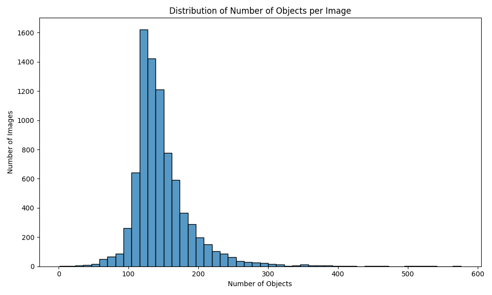
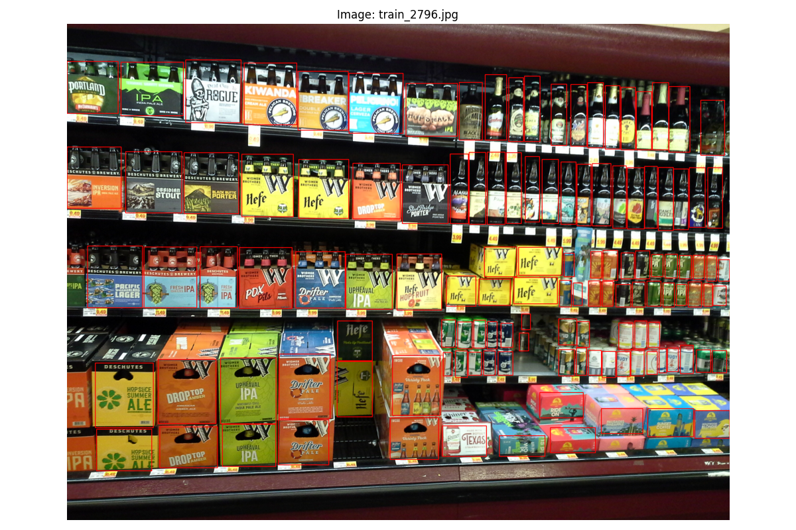

# Exploratory Data Analysis of the SKU110K Dataset

## Introduction
This report presents an exploratory data analysis (EDA) of the SKU110K dataset, which is utilized for object detection in a supermarket environment. The dataset comprises images of grocery items accompanied by annotations specifying the locations of objects within each image. The purpose of this analysis is to understand the dataset's characteristics, including the distribution of objects, bounding box dimensions, and other pertinent statistics, to inform the development of an effective object detection model.

## Dataset Overview
- **Total number of images:** 8,219
- **Total number of annotations (objects):** 1,208,482
- **Average number of objects per image:** 147.04
- **Median number of objects per image:** 138
- **Maximum number of objects in an image:** 576
- **Minimum number of objects in an image:** 1

The dataset is substantial, with over 1.2 million object annotations across 8,219 images. On average, each image contains approximately 147 objects, indicating that images are densely packed with items, which is typical of supermarket shelves.

## Distribution of Objects per Image
- **Average:** 147.04 objects per image
- **Median:** 138 objects per image
- **Range:** 1 to 576 objects per image

Most images contain a high number of objects, with the majority having between 100 and 200 objects. A small number of images have either very few or a very high number of objects, as indicated by the minimum and maximum values.

> **Note:** A histogram was generated to visualize this distribution, showing a peak around the average number of objects per image.

## Bounding Box Analysis

### Bounding Box Width
- **Count:** 1,208,482
- **Mean:** 120.81 pixels
- **Standard Deviation:** 72.59 pixels
- **Minimum:** 21 pixels
- **25th Percentile:** 74 pixels
- **Median:** 103 pixels
- **75th Percentile:** 146 pixels
- **Maximum:** 2,226 pixels

The bounding box widths vary significantly, with most widths ranging between 74 and 146 pixels. The mean width is approximately 121 pixels. The maximum width of 2,226 pixels is considerably larger than the mean, indicating the presence of some very wide bounding boxes.

### Bounding Box Height
- **Count:** 1,208,482
- **Mean:** 190.11 pixels
- **Standard Deviation:** 96.28 pixels
- **Minimum:** 21 pixels
- **25th Percentile:** 113 pixels
- **Median:** 181 pixels
- **75th Percentile:** 253 pixels
- **Maximum:** 2,283 pixels

Similarly, the bounding box heights show considerable variation, with most heights between 113 and 253 pixels. The mean height is approximately 190 pixels. The maximum height of 2,283 pixels indicates some tall bounding boxes.

### Bounding Box Area
- **Count:** 1,208,482
- **Mean:** 22,196 pixels²
- **Standard Deviation:** 17,801 pixels²
- **Minimum:** 441 pixels²
- **25th Percentile:** 11,102 pixels²
- **Median:** 18,328 pixels²
- **75th Percentile:** 28,272 pixels²
- **Maximum:** 2,488,668 pixels²

The bounding box areas vary widely, with most areas between 11,102 and 28,272 pixels². The mean area is approximately 22,196 pixels². The maximum area is significantly larger, indicating some very large bounding boxes.

### Bounding Box Aspect Ratio
- **Count:** 1,208,482
- **Mean:** 0.930
- **Standard Deviation:** 1.042
- **Minimum:** 0.046
- **25th Percentile:** 0.349
- **Median:** 0.534
- **75th Percentile:** 1.082
- **Maximum:** 38.20

The aspect ratio (width divided by height) of the bounding boxes varies, with a mean of 0.930, indicating that, on average, bounding boxes are taller than they are wide. The median aspect ratio is 0.534, suggesting that a significant number of objects are much taller than they are wide. The maximum aspect ratio of 38.20 indicates some extremely wide bounding boxes relative to their height.

## Class Distribution
- **Number of unique classes:** 1

All annotations belong to a single class. This implies that the dataset focuses on detecting objects without differentiating between different types of products.

## Relative Bounding Box Dimensions
To understand the size of the objects relative to the images they are in, we calculate the relative dimensions:

### Relative Bounding Box Width
- **Mean:** 0.0497
- **Standard Deviation:** 0.0282
- **Minimum:** 0.0050
- **25th Percentile:** 0.0310
- **Median:** 0.0437
- **75th Percentile:** 0.0607
- **Maximum:** 0.8588

On average, bounding box widths are about 5% of the image width, indicating that objects are relatively small compared to the overall image size.

### Relative Bounding Box Height
- **Mean:** 0.0612
- **Standard Deviation:** 0.0321
- **Minimum:** 0.0041
- **25th Percentile:** 0.0352
- **Median:** 0.0586
- **75th Percentile:** 0.0821
- **Maximum:** 0.6994

Similarly, bounding box heights are about 6% of the image height on average.

### Relative Bounding Box Area
- **Mean:** 0.00287
- **Standard Deviation:** 0.00212
- **Minimum:** 0.000033
- **25th Percentile:** 0.00148
- **Median:** 0.00244
- **75th Percentile:** 0.00370
- **Maximum:** 0.2084

The relative area indicates that bounding boxes cover a small fraction of the image area, with most bounding boxes covering less than 0.37% of the image area (75th percentile).

> **Note:** Histograms were generated for the distributions of relative bounding box width, height, and area.

## Correlation Analysis

### Correlation between Bounding Box Width and Image Width
- **Correlation Coefficient:** 0.197

The correlation between bounding box width and image width is weak (correlation coefficient of 0.197). This suggests that larger images do not necessarily contain larger bounding boxes in terms of width.

### Correlation between Bounding Box Height and Image Height
- **Correlation Coefficient:** 0.069

Similarly, the correlation between bounding box height and image height is very weak (correlation coefficient of 0.069), indicating that bounding box heights are not significantly influenced by image heights.

## Sample Images with Bounding Boxes
A set of sample images was selected randomly to visualize the bounding boxes. These images illustrate:
- The high density of objects in each image.
- The relatively small size of each object compared to the entire image.
- The uniformity of object classes, given that there is only one class.

> **Note:** Sample images with bounding boxes were saved for reference.

## Implications for Model Development
Based on the EDA findings, several considerations emerge for model development:
- **High Object Density:** With an average of 147 objects per image, the model must handle images with a high density of objects, requiring efficient handling of multiple detections.
- **Small Object Sizes:** Objects occupy a small fraction of the image area, with bounding boxes covering, on average, less than 0.3% of the image. The model must be adept at detecting small objects.
- **Single Class Detection:** Since all annotations belong to a single class, the model's focus will be on object localization rather than classification among multiple classes.
- **Variability in Bounding Box Dimensions:** The wide range of bounding box sizes and aspect ratios suggests that the model needs to be robust to detect objects of various shapes and sizes.
- **Weak Correlation with Image Dimensions:** The low correlation between bounding box and image dimensions indicates that object sizes are relatively consistent across different image sizes, which may simplify normalization and scaling strategies.

